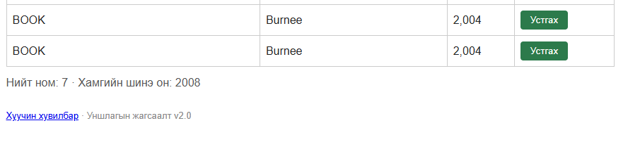

# BUG-01 — Ижил номыг хоёр удаа нэмэх боломжтой

Орчин — Багшийн өгсөн Уншлагын жагсаалт, Windows, Node.js v22.23.3, curl. Тусдаа локал instance дээр шалгасан.

Урьдчилсан нөхцөл — Аппыг шинээр асаасан. Эхний гурван ном байгаа.

## Дахин гаргах алхам

1. GET /api/books хүсэлтээр анхны жагсаалтыг шалгана.
2. POST /api/books хүсэлтэд Content-Type: application/json болон доорх биеийг ашиглана. Ижил JSON-оор POST хүсэлтийг хоёр удаа илгээнэ.
3. GET /api/books хүсэлтээр хадгалагдсан жагсаалтыг шалгана.

```json
{"title":"River Notes","author":"Mara Reed","year":1999}
```

**Хүлээгдсэн үр дүн** — Эхний хүсэлт нэг ном нэмнэ. Хоёр дахь хүсэлт давхардлыг мэдээлж, дахин нэмэхгүй.

**Бодит үр дүн** — Хоёр хүсэлт хоёулаа HTTP 201 Created буцаасан. Жагсаалтад ижил ном хоёр өөр ID-тай харагдсан.

**Ноцтой байдал** — Major. Давхардсан ном бүртгэгдэж, жагсаалт болон тоолуурын утга өөрчлөгдөнө.

**Аялал** — Saboteur, локал API шалгалт.

[HTTP хариуны бүтэн гаралт](../evidence/duplicate-book-curl.txt)

## Хэрэглэгчийн дэлгэц дээрх нотолгоо

Браузерын хүснэгтэд BOOK / Burnee / 2004 гэсэн ижил утгатай хоёр мөр харагдсан.


