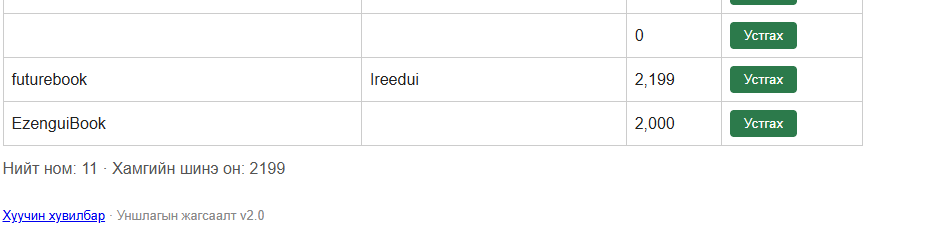

# BUG-02 — Зохиолч хоосон ном хадгалагддаг

Орчин — Багшийн өгсөн Уншлагын жагсаалт, Windows, Node.js v22.23.3, curl. Тусдаа локал instance дээр шалгасан.

Урьдчилсан нөхцөл — Аппыг шинээр асаасан. Эхний гурван ном байгаа.

## Дахин гаргах алхам

1. GET /api/books хүсэлтээр анхны жагсаалтыг шалгана.
2. POST /api/books хүсэлтэд Content-Type: application/json болон доорх биеийг ашиглана. JSON-оор нэг POST хүсэлт илгээнэ.
3. GET /api/books хүсэлтээр хадгалагдсан жагсаалтыг шалгана.

```json
{"title":"Harbor Notes","author":"","year":1999}
```

**Хүлээгдсэн үр дүн** — Зохиолч заавал бөглөгдөх учраас ном нэмэгдэхгүй, тодорхой алдаа ирнэ.

**Бодит үр дүн** — HTTP 201 Created буцаж, жагсаалтад зохиолчийн утга хоосон ном хадгалагдсан.

**Ноцтой байдал** — Major. Заавал байх мэдээлэл дутуу бүртгэл үүснэ.

**Аялал** — Saboteur, локал API шалгалт.

[HTTP хариуны бүтэн гаралт](../evidence/missing-author-curl.txt)

## Хэрэглэгчийн дэлгэц дээрх нотолгоо

Браузерын хүснэгтэд EzenguiBook гарчиг, 2000 онтой ном зохиолчгүй хадгалагдсан. Өмнөх туршилтад гарчиг, зохиолч хоосон, он 0 гэсэн мөр мөн гарсан. [Өмнөх дэлгэцийн зураг](../screenshots/bug-02-empty-row.png).



