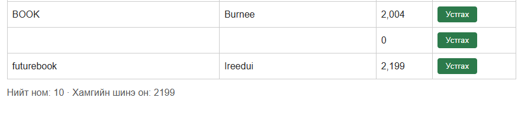

# BUG-03 — Зөвшөөрөгдсөн хязгаараас их оныг хадгалдаг

Орчин — Багшийн өгсөн Уншлагын жагсаалт, Windows, Node.js v22.23.3, curl. Тусдаа локал instance дээр шалгасан.

Урьдчилсан нөхцөл — Аппыг шинээр асаасан. Эхний гурван ном байгаа.

## Дахин гаргах алхам

1. GET /api/books хүсэлтээр анхны жагсаалтыг шалгана.
2. POST /api/books хүсэлтэд Content-Type: application/json болон доорх биеийг ашиглана. JSON-оор нэг POST хүсэлт илгээнэ.
3. GET /api/books хүсэлтээр хадгалагдсан жагсаалтыг шалгана.

```json
{"title":"Future Notes","author":"Mara Reed","year":2101}
```

**Хүлээгдсэн үр дүн** — Он 1000–2100-ын хооронд байх ёстой тул 2101 онтой ном нэмэгдэхгүй.

**Бодит үр дүн** — HTTP 201 Created буцаж, жагсаалтад ном 2101 онтой хадгалагдсан.

**Ноцтой байдал** — Major. Жагсаалт тодорхойлолтын хязгаараас гадуур өгөгдөл агуулна.

**Аялал** — Saboteur, локал API шалгалт.

[HTTP хариуны бүтэн гаралт](../evidence/year-out-of-range-curl.txt)

## Хэрэглэгчийн дэлгэц дээрх нотолгоо

Браузерын хүснэгтэд futurebook / Ireedui номын он 2199 гэж хадгалагдаж, «Хамгийн шинэ он» мөн 2199 болсон. Дээрх API туршилтад 2101 оныг ашигласан. Аль аль нь зөвшөөрсөн 2100 дээд хязгаараас их.


